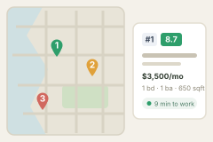

  

# Apartment Hunt

  

Didn't work? Create a Minds workspace and paste this to your agent:
` /use-template https://github.com/gnguralnick/apartment-hunt`

## Why you care

Hunting for an apartment means checking a dozen landlord sites, each with its
own listings, formats, and quirks, and holding the comparison in your head.
Apartment Hunt pulls all of those into one place, ranks the results by what you
actually care about -- price, space, and how far each place is from the spots
that matter to you -- and puts them on a map so you can see your options at a
glance instead of juggling twenty browser tabs.

## How to use it

Open the **Apartment Hunt** tab. You get a map of San Francisco with a numbered,
rank-colored pin on every listing, next to a sortable list of listing cards.

- **Scrape All** pulls fresh listings from ~18 landlord sources. New listings
  since your last scrape are flagged.
- **Sort** the cards by score, rent, size, or bedrooms; click a card to expand
  its details and fly the map to its pin (and vice versa).
- **Config** lets you set your hard filters (rent, bedrooms, bathrooms, sqft,
  city, pets), your soft preferences and how strongly each counts (dishwasher,
  in-unit laundry, more space, lower rent), and your **waypoints** -- the places
  you want to be near, each with a walk/transit time budget. **Apply changes**
  re-ranks everything instantly.
- **Mark up** listings as you go: hide, contacted, toured, a star rating, and
  free-text notes. It all persists between sessions.

Scoring blends your preferences with travel time to each waypoint (walking is
preferred; transit is discounted). Set the `GOOGLE_MAPS_API_KEY` environment
variable for real Google walk/transit times; without it, the app estimates from
straight-line distance.

## Ideas for making it yours

- **Hunt in a different city.** Repoint the scrapers and seed preferences at
  your own market's landlord sites and Craigslist region.
- **Add a source.** Drop a new scraper module in `scrapers/`, implement the
  small `Scraper` protocol, and register it -- one import line in
  `scrapers/catalog.py`.
- **Change how listings are scored.** Add a new preference dimension (commute to
  a second job, distance to transit, a "quietness" heuristic) in `scoring.py`.
- **Auto-refresh.** Put the scrape on a schedule so the board is always fresh
  instead of scraping on demand.
- **Broaden the criteria.** The default preferences lean toward a one-bedroom in
  SF -- widen the filters for studios, roommates, or a different budget.

## What this is

This repository is a published **minds template**: a clean, bootable
snapshot of what a mind built, ready to adapt into your own. It is NOT the
generic workspace template -- it is this specific project.

[`template.md`](template.md) is the full manifest -- what it is, how it
works, what it needs to run, and what to adapt -- with the
machine-readable half (recipe, requirements, and the environment it needs
installed) in [`template.toml`](template.toml).
